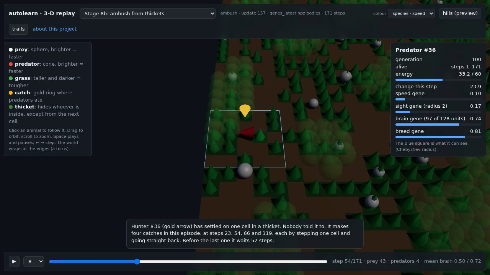

# How I grew AI brains from zero

**Two species start with blank brains. Nobody tells them how to hunt, hide or eat. Most of the experiments fail, and
that's the point.**

**[▶ Watch the real trained animals in 3-D, in your browser](https://alltomstales-dotcom.github.io/how-i-grew-ai-brains/)** · [The video series](#the-videos) · [Suggest an experiment](SUGGESTIONS.md)

[](https://alltomstales-dotcom.github.io/how-i-grew-ai-brains/watch/?run=pp-ambush-001&follow=36&step=15&speed=4&play=1)

Grazers and hunters share a small world. They learn by trial and error while their bodies and brains evolve. Each
stage adds one pressure to the world, with a pass bar written down **before** any training run. The bar doesn't move
afterwards, however close the miss.

## The story so far

**Blank brains.** Hunters learned to catch and grazers learned to survive, beating random animals 3.36x and 1.61x. Then
grazers got so good at dodging, within minutes, that the hunters starved. Learning stopped, because the world had stopped
asking anything new.

**Evolution takes whatever is free.** Given genes that cost energy, hunters in the first evolution runs drifted toward blindness. The first test
of evolution then passed with brains that had never trained, so it was measuring the wrong thing. Every test since has
a control.

**One line of code.** Walls helped hunters catch more, but their skill still stalled. Grazers never learned to use
burrows, training against past opponents didn't fix the stall, and memory missed its bar. Worst of all, a one-line
hand-written rule, "step toward the nearest prey", did about as well as the trained hunters in the evolution world
(0.83-1.06x). More learning wasn't going to help. The world had to give them a way to win.

**Teamwork that isn't.** Requiring two hunters per catch failed: chasers meet at the nearest prey anyway (1.02-1.04x,
bar 1.5x). Signals failed too: animals signalled constantly, and blanking the signal cost under 1% of catches.

**The pincer.** Then a rule that the chaser can't satisfy by accident: hunters must stand on opposite sides of the
prey. Trained hunters beat the chaser 3.0-3.8x on two seeds. It's the first stage where learning clearly beats a
simple rule.

**Species that wouldn't split.** Six versions of a world meant to split one population in two all failed. The last
reached 1.95 on a measure with a bar of 2.0. The bar stayed at 2.0.

**Brains cost food.** With brain size as a gene at a flat energy cost, brain size just followed how much an animal ate.
Charged instead as a share of each meal, evolution kept about three times as much brain where thinking pays (0.53
against 0.18; on a second seed, 0.47 against 0.14).

**Hills.** Hunters took the high ground (78% of their time, against 64% at random), but the test failed: zeroing the
slope sense barely changed catches.

**A viewer's idea: hiding.** A viewer commented that real predators hide to save energy. The world couldn't reward that,
since moving cost the same as standing still. So walking now costs energy and thickets hide whoever is inside. Hunters
started waiting in cover, standing still 90-93% of the time, and caught 68-72% less when thickets stopped hiding them.
**But hiding only matches chasing per meal:** a one-line chaser catches more and burns more. Learning found a second way
to make the same living, not a better one.

**Tasting.** One plant feeds and the other poisons. Nothing shows which, and they swap at random. Brains with memory
took 85% and 76% good bites soon after a swap, against 64% with no memory, and wiping the memory took them back down to
66% and 60%. **Memory is mostly speed:** brains with none also recover, later. And this is memory inside a trained
network, not changing weights: what an animal "learns" lives in its memory state, and the ability to do that was
learned by the species.

**So far, [6 stages pass and 8 fail](docs/results.md).** The failures have often taught more than the passes.

## Watch it

The [replay viewer](https://alltomstales-dotcom.github.io/how-i-grew-ai-brains/) plays back real episodes from trained
runs in your browser, and you can click any animal to follow it and see its genes. Two moments to start with:

- **[Hunter #36 waits](https://alltomstales-dotcom.github.io/how-i-grew-ai-brains/watch/?run=pp-ambush-001&follow=36&step=15&speed=4&play=1):**
  four catches in one episode from one cell in a thicket, each by stepping one cell and going straight back.
- **[Grazer #354 tastes](https://alltomstales-dotcom.github.io/how-i-grew-ai-brains/watch/?run=pp-life-gru-0&follow=354&step=166&speed=2&play=1):**
  its first bite is poison, and its next 11 are all the kind that feeds.

## The videos

The series is on [NeatScienceStuff](https://www.youtube.com/@NeatScienceStuff), with a [playlist](https://www.youtube.com/playlist?list=PLef2iL8vMOzs). New parts go out at 11 pm US Central.

<!-- videos:start -->
| Part | Title | Watch |
|---|---|---|
| 1 | I gave two species blank AI brains. The hunters starved. | [Watch](https://youtu.be/Y4Up4N4FfQI) |
| 2 | Evolution made my AI hunters nearly blind | coming Oct 30 |
| 3 | My AI hunters barely beat one line of code | coming Oct 31 |
| 4 | My AI hunters only got smart when they had to surround their prey | coming Nov 1 |
| 5 | I let evolution decide how big my AI's brain should be | coming Nov 2 |
| 6 | I gave my AI hunters hills. They took the high ground. | coming Nov 3 |
| 7 | A viewer said my AI hunters should hide. So I let them. | coming Nov 4 |
| 8 | I gave my AI creatures poisoned food, and they learned to taste | coming Nov 5 |
<!-- videos:end -->

## Build this with us

This project grows with the people watching it. The ambush stage came from a viewer's comment on Part 1, and more ideas
are queued. [SUGGESTIONS.md](SUGGESTIONS.md) shows each idea, who suggested it, its status and its result.

**[Suggest an experiment](https://github.com/alltomstales-dotcom/how-i-grew-ai-brains/issues/new?template=suggest-an-experiment.yml)**,
no code needed, or read [CONTRIBUTING.md](CONTRIBUTING.md).

## Read more

- **[How it works](docs/how-it-works.md)**, in plain language
- **[Results](docs/results.md)**: every stage in one table, with caveats
- **[Specs](docs/specs/README.md)**: each stage's rules and bar, written before its runs
- **[Roadmap](docs/roadmap.md)** and **[reading list](docs/reading-list.md)**

## Run it yourself

You need [uv](https://docs.astral.sh/uv/) and Python 3.11 or newer. A tiny training run works on a laptop CPU, though
it's too short to learn anything interesting. The full test suite takes about 15 minutes.

```bash
git clone https://github.com/alltomstales-dotcom/how-i-grew-ai-brains
cd how-i-grew-ai-brains
uv sync
uv run pytest -q

# A tiny run, then a replay of it in the 3-D viewer
uv run python -m scripts.train --tiny --world evo --runs-dir runs --run-id try --updates 4 --ckpt-every 2
uv run python -m scripts.episode3d --run-dir runs/try
uv run python -m scripts.site --runs-dir runs
uv run python -m http.server 8000 --bind 127.0.0.1 --directory runs
# open http://127.0.0.1:8000/world3d.html
```

### Real training on a GPU

Real runs took about 30 minutes each on an NVIDIA DGX Spark. The scripts in `deploy/` copy the code to a GPU machine
over SSH and run it in Docker. They're set up through environment variables:

| Variable | Meaning |
|---|---|
| `AUTOLEARN_HOST` | **Required.** SSH host of the GPU machine |
| `AUTOLEARN_REMOTE_DIR` | Where the code goes on it (default `autolearn`, in its home folder) |
| `AUTOLEARN_IMAGE` | Docker image name (default `autolearn:latest`) |
| `AUTOLEARN_DASH_IP` | Private address for the dashboard (default: the machine's Tailscale address) |
| `HEADROOM_GB`, `EVAL_GB` | Memory always left free (8), and the cap for test runs (8) |

```bash
export AUTOLEARN_HOST=my-gpu-box
deploy/spark.sh sync                     # copy the code over
deploy/spark.sh build                    # build the JAX image (first time, or after Dockerfile changes)
deploy/spark.sh smoke                    # check JAX sees the GPU
deploy/spark.sh train --run-id pp-001    # start training (4 h cap by default)
deploy/spark.sh train --world ambush --run-id pp-ambush-001
deploy/spark.sh logs                     # follow progress
deploy/spark.sh eval --run-dir runs/pp-001
deploy/spark.sh ambush --run-dir runs/pp-ambush-001 --evolved   # each stage has its own test
deploy/spark.sh dash                     # run dashboard, private address only: it has no login
deploy/spark.sh stop                     # stop autolearn containers only
```

The Dockerfile starts from NVIDIA's JAX image, which was built for the DGX Spark's GPU; another machine may need a
different base image. Memory is capped at 12 GiB per trainer by default (`--mem-gb`). Only containers named
`autolearn-*` are ever touched.

## How this was made

The idea of a "Crucible", a simple world where agents learn from scratch without human data, comes from David Silver and
Lasse Espeholt. The project is directed by Tom Myers. Most of the code, specs and analysis were written with
[Claude Code](https://claude.com/claude-code), an AI coding agent. Fresh reviews found real bugs in that work, and the
specs say where.

## License

[MIT](LICENSE). The [three.js](https://threejs.org) files in `viz/dashboard/vendor` keep [their own MIT licence](viz/dashboard/vendor/LICENSE).
